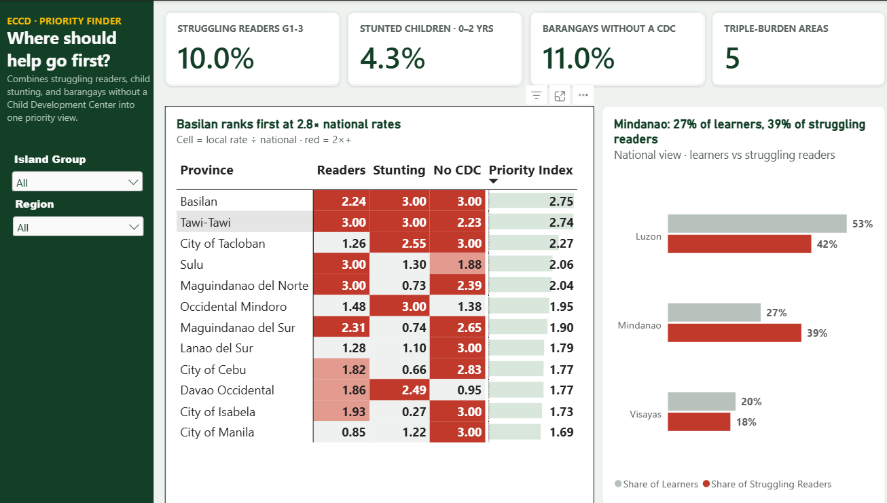

# 🧒 ECCD Priority Finder
### Which Philippine barangays need early-childhood help first, and why?

-0B2545)

> **A data analytics case study.** I turned EDCOM2's public Early Childhood Dashboard data into a single **priority index** that tells local coalitions *where to act first* and *why*. I also documented 4 data-quality issues in the source.

---

## 📌 TL;DR
| | |
|---|---|
| **Question** | Where should limited ECCD funds go first? |
| **Answer** | **Basilan (2.75×)** and **Tawi-Tawi (2.74×)**: both are triple-burden provinces at about 2.7× the national rates |
| **Surprise** | Large provinces like **Cebu, Camarines Sur and Pangasinan** have the *most children affected*, but a rate-only view hides them |
| **Data quality** | Found **4 issues** in the public source, including **~16,000 schools merged by name** |

---

## 1. The problem
The EDCOM2 Early Childhood Dashboard tracks three early-childhood crises:

| Indicator | National rate | Scale |
|---|---|---|
| Grade 1–3 struggling readers | **10.0%** | 511,753 learners |
| Stunted children | **4.3%** | ~129,800 children |
| Barangays without a Child Development Center (CDC) | **11.0%** | 4,603 barangays |

The dashboard shows each problem **separately**. A local coalition with limited funds still has to work out the answer to one question on its own:

> **Where should we act first, and why?**

## 2. Data
| Source | Indicator | As of |
|---|---|---|
| DepEd CRLA (via EDCOM2) | Struggling readers by school and LGU | End of SY 2025–26 |
| DOH/NNC Operation Timbang Plus | Stunting by LGU | 2025 |
| DILG CBMS | Barangays without a CDC | Sep 2025 |

**Coverage:** 118 provinces/HUCs · 1,655 municipalities · 4,603 barangays without a CDC. All data was downloaded from the public EDCOM2 dashboard.

## 3. Method
1. **Cleaned and joined the data (Python/pandas).** I fixed UTF-16 file encoding, split "Province, Region" fields, and matched municipality names across sources.
2. **Built the ECCD Priority Index:****1.0 = national average · 2.0 = twice the national rate.** The index is left blank if an indicator is missing.
3. **Burden level** = how many of the 3 indicators are above the national average: **Triple · Double · Single**.
4. **Children affected** = struggling readers + stunted children. This captures the **volume** of need alongside the **rate**.

## 4. Key findings
1. **Basilan (2.75) and Tawi-Tawi (2.74) need help first.** Both are red on all three indicators.
2. **Only 5 provinces/HUCs carry a triple burden.** That's where combined programs (reading + nutrition + CDC) pay off most.
3. **Rate ≠ volume.** BARMM leads on *rate*, but Cebu, Camarines Sur and Pangasinan lead on *number of children affected*.
4. **Mindanao has 27% of learners but 39% of struggling readers.** Funding reading programs by enrolment alone would under-serve it.

## 5. Data quality issues found in the source
| # | Issue | Evidence | Recommendation |
|---|---|---|---|
| 1 | Schools grouped by **name**, not School ID | 32,197 rows vs. 48,255 schools; "San Isidro ES" shows 11,540 learners | Key the table by DepEd School ID |
| 2 | Manila stunting **repeated per district** | City-wide figure (2,424) repeated in all 14 districts, ~31,500 extra | Report Manila stunting at city level only |
| 3 | **Implausible stunting rates** | 19 municipalities above 30% (Jovellar, Albay: 66.8%) | Verify OPT Plus coverage with NNC |
| 4 | **Mixed reference dates** | Sep 2025, Mar 2026 and May 2026 | Show a "data as of" date on each indicator |

## 6. Recommendations
- **For coalitions:** start with **triple-burden** areas. Pair CDC construction with feeding programs where stunting is also high.
- **For EDCOM2:** fix the 4 data-quality issues above, and add a ranked "act here first" view to the dashboard.

## 7. Limitations
- Equal weights are a **starting point**, not a policy decision.
- Some municipal rates rest on small samples (under 100 children assessed); these are flagged.
- **Prototype only.** Verify figures against official agency releases before using them for policy.

## 8. Files in this repo
| File | Contents |
|---|---|
| `ECCD_Priority_Finder.pbix` | Power BI dashboard |
| `ECCD_Clean_Data.xlsx` | Cleaned data, with README and data-quality sheets |
| `page*.png` | Dashboard screenshots |

---
**Jarred Tañedo** · Mechanical Engineering faculty → Data Analyst
🔗 [LinkedIn](www.linkedin.com/in/jarred-jeff-bandong-ta�edo-367667354) · 🌐 Portfolio *(coming soon)*
